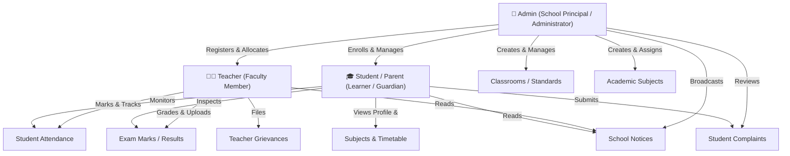

# Edu-365 School Management System — Architecture & Workflow Documentation

Welcome to the comprehensive technical documentation for the **Edu-365 School Management System**. This documentation provides an in-depth breakdown of the system's Frontend, Backend, and Database workflows, explaining how data moves through the application layers and how different user roles interact with the platform.

---

## 📑 Documentation Index

The documentation suite is split into modular guides:

| Document | Purpose & Key Topics Covered |
| :--- | :--- |
| **[Lumina Frontend Architecture](./lumina-frontend-architecture.md)** | **Modernization Blueprint**: "INTERNATIONAL KNOWLEDGE CAMPUS: UNESCO Open Education Ecosystem" design system, glassmorphism, UNESCO Blue / Emerald Green palette, and clean API client adapter architecture. |
| **[Frontend Workflow](./frontend-workflow.md)** | React 18 component hierarchy, Redux Toolkit state lifecycle, role-based navigation, Material-UI dashboards, guest access mode, and data visualization. |
| **[Backend Workflow](./backend-workflow.md)** | Express.js middleware pipeline, REST API routing, controller logic, bcrypt authentication, validation, cascade deletions, and error handling. |
| **[Database Workflow](./database-workflow.md)** | MongoDB & Mongoose schemas, Entity-Relationship (ER) design, cross-document references, populate strategies, unique constraints, and cascade workflows. |
| **[End-to-End Workflows](./end-to-end-workflows.md)** | End-to-end sequence diagrams for Admin initialization, Teacher-Subject assignment, Student enrollment, Attendance marking, Exam grading, and Grievance handling. |

---

## 🏛️ High-Level System Architecture

The application is structured on the **MERN** stack (MongoDB, Express.js, React.js, Node.js) with strict separation of concerns across client, application server, and persistence layers.

```mermaid
flowchart TD
    subgraph ClientLayer["🖥️ Frontend (React 18 + Redux Toolkit)"]
        UI["UI Layer (Material UI + Styled Components)"]
        Router["React Router v6 (Role-Based Routing)"]
        Store["Redux Toolkit Store (6 Slices)"]
        AxiosClient["Axios HTTP Client (Base URL: localhost:5000)"]
        
        UI --> Router
        Router --> Store
        Store <--> AxiosClient
    end

    subgraph ServerLayer["⚙️ Backend (Node.js + Express.js)"]
        CORS["CORS Middleware (Allowed Origins & Localhost)"]
        BodyParse["JSON Body Parser (Limit: 10MB)"]
        Routes["Express Router (route.js)"]
        
        subgraph Controllers["Controller Modules"]
            AdminCtrl["admin-controller.js"]
            ClassCtrl["class-controller.js"]
            SubjectCtrl["subject-controller.js"]
            TeacherCtrl["teacher-controller.js"]
            StudentCtrl["student_controller.js"]
            NoticeCtrl["notice-controller.js"]
            ComplainCtrl["complain-controller.js"]
        end

        CORS --> BodyParse --> Routes
        Routes --> Controllers
    end

    subgraph DataLayer["🗄️ Database (MongoDB / Mongoose 7)"]
        AdminColl[("Admins")]
        SclassColl[("Sclasses")]
        SubjectColl[("Subjects")]
        TeacherColl[("Teachers")]
        StudentColl[("Students")]
        NoticeColl[("Notices")]
        ComplainColl[("Complains")]

        Controllers <--> DataLayer
    end

    AxiosClient <-->|"REST API Requests / JSON Responses"| CORS
```

---

## 👥 Role Hierarchy & Access Levels

The system implements strict Role-Based Access Control (**RBAC**) across three distinct user roles:



---

## 📁 Repository Structure Overview

```
school-management-system/
├── backend/                    # Node.js + Express backend
│   ├── controllers/            # Controller business logic
│   │   ├── admin-controller.js
│   │   ├── class-controller.js
│   │   ├── complain-controller.js
│   │   ├── notice-controller.js
│   │   ├── student_controller.js
│   │   ├── subject-controller.js
│   │   └── teacher-controller.js
│   ├── models/                 # Mongoose schema definitions
│   │   ├── adminSchema.js
│   │   ├── classSchema.js
│   │   ├── complainSchema.js
│   │   ├── noticeSchema.js
│   │   ├── studentSchema.js
│   │   ├── subjectSchema.js
│   │   └── teacherSchema.js
│   ├── routes/
│   │   └── route.js            # Central API route definitions
│   ├── .env                    # PORT and MONGO_URL configuration
│   ├── index.js                # Express app entrypoint & middleware
│   └── package.json
│
├── frontend/                   # React.js single-page application
│   ├── public/                 # Static assets, HTML shell, icons
│   ├── src/
│   │   ├── assets/             # Images, illustrations, and logos
│   │   ├── components/         # Reusable UI widgets & styled wrappers
│   │   ├── pages/              # Routed screen components
│   │   │   ├── admin/          # Admin portal pages (Class, Teacher, Student, Notice)
│   │   │   ├── teacher/        # Teacher portal pages (Class, Attendance, Marks)
│   │   │   ├── student/        # Student portal pages (Attendance, Results, Complains)
│   │   │   ├── ChooseUser.js   # Role selection landing page
│   │   │   ├── Homepage.js     # Public marketing / hero page
│   │   │   └── LoginPage.js    # Multi-role authentication page
│   │   ├── redux/              # Redux Toolkit global state store
│   │   │   ├── userRelated/    # Session, authentication, roles
│   │   │   ├── studentRelated/ # Student records & grades
│   │   │   ├── teacherRelated/ # Faculty records & classes
│   │   │   ├── sclassRelated/  # Class & subject relationships
│   │   │   ├── noticeRelated/  # School board announcements
│   │   │   ├── complainRelated/# Grievance tracking
│   │   │   └── store.js        # Configured central store
│   │   ├── App.js              # Root router & role switcher
│   │   └── index.js            # DOM renderer & store provider
│   ├── .env                    # REACT_APP_BASE_URL configuration
│   └── package.json
│
└── docs/                       # Workflow and technical documentation
    ├── README.md               # Master index & high-level architecture
    ├── frontend-workflow.md    # Frontend components & state flow
    ├── backend-workflow.md     # Backend API routes & controllers
    ├── database-workflow.md    # Database schemas & relationships
    └── end-to-end-workflows.md # Sequence diagrams of user journeys
```
