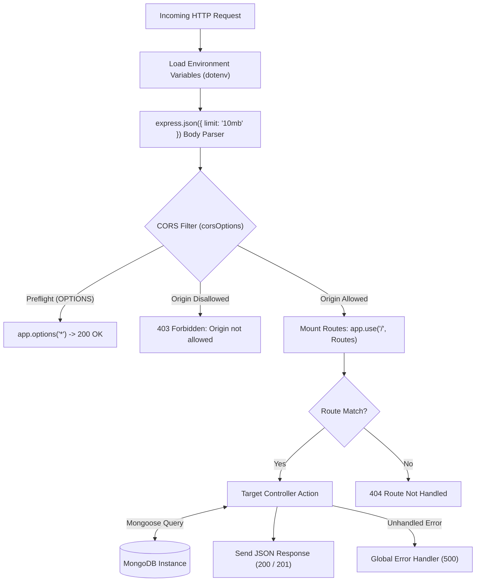
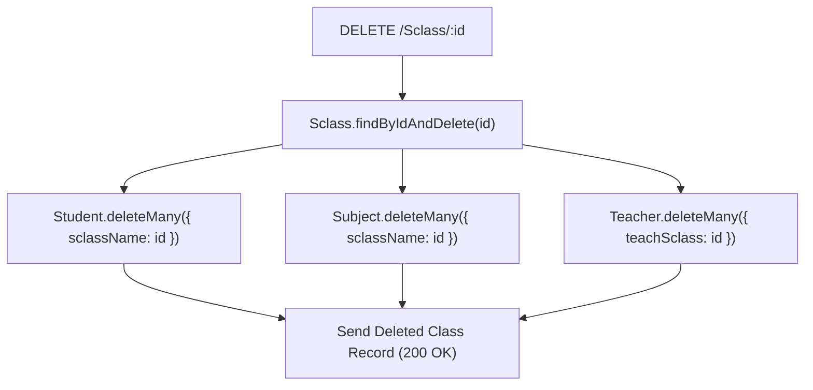

# Backend Workflow & Architecture

The backend of **Edu-365** is built on **Node.js** and **Express.js**, serving as a robust RESTful API layer. It coordinates business logic, password encryption, institutional role segregation, cascade integrity, and database operations with MongoDB via Mongoose.

---

## ⚙️ Server Architecture & Middleware Pipeline

The Express application starts at `backend/index.js` and processes requests through a sequential middleware chain:



### 1. CORS Security Configuration
To protect cross-origin requests while supporting local development and cloud deployments, `backend/index.js` uses dynamic origin evaluation:

```javascript
const allowedOrigins = [
  "https://school-management-system-hazel-eta.vercel.app",
  "http://localhost:3000",
  "http://127.0.0.1:3000",
];

const corsOptions = {
  origin: function (origin, callback) {
    if (
      !origin ||
      allowedOrigins.includes(origin) ||
      /^http:\/\/(localhost|127\.0\.0\.1)(:\d+)?$/.test(origin)
    ) {
      callback(null, true);
    } else {
      console.warn(`Blocked CORS for origin: ${origin}`);
      callback(new Error("Not allowed by CORS"));
    }
  },
  methods: ["GET", "POST", "PUT", "DELETE", "OPTIONS"],
  allowedHeaders: ["Content-Type", "Authorization"],
  credentials: true,
  optionsSuccessStatus: 200,
};
```

---

## 📡 REST API Endpoint Registry

All routes are mounted at the root (`/`) through `backend/routes/route.js`:

### 👑 Admin Routes
| Method | Endpoint | Controller Handler | Purpose |
| :--- | :--- | :--- | :--- |
| `POST` | `/AdminReg` | `adminRegister` | Hashes password (salt 10), ensures unique email & schoolName, saves admin. |
| `POST` | `/AdminLogin` | `adminLogIn` | Compares bcrypt hash, returns admin record without password. |
| `GET` | `/Admin/:id` | `getAdminDetail` | Fetches admin metadata by Admin ID. |
| `PUT` | `/Admin/:id` | `updateAdmin` | Updates admin profile (hashes new password if modified). |

### 🏫 Class (`Sclass`) Routes
| Method | Endpoint | Controller Handler | Purpose |
| :--- | :--- | :--- | :--- |
| `POST` | `/SclassCreate` | `sclassCreate` | Creates classroom for school; validates unique class name per school. |
| `GET` | `/SclassList/:id` | `sclassList` | Returns all classes belonging to `school: id`. |
| `GET` | `/Sclass/:id` | `getSclassDetail` | Retrieves class details populated with `school` name. |
| `GET` | `/Sclass/Students/:id` | `getSclassStudents` | Lists all students enrolled in class (passwords stripped). |
| `DELETE` | `/Sclass/:id` | `deleteSclass` | **Cascading Delete**: Removes class, enrolled students, subjects, & teachers. |
| `DELETE` | `/Sclasses/:id` | `deleteSclasses` | Deletes all classes of a school and cascades all child collections. |

### 📚 Subject Routes
| Method | Endpoint | Controller Handler | Purpose |
| :--- | :--- | :--- | :--- |
| `POST` | `/SubjectCreate` | `subjectCreate` | Batch creates subjects for class; enforces unique `subCode` per school. |
| `GET` | `/AllSubjects/:id` | `allSubjects` | Lists all subjects in school populated with class names. |
| `GET` | `/ClassSubjects/:id` | `classSubjects` | Lists subjects assigned to a specific class ID. |
| `GET` | `/FreeSubjectList/:id` | `freeSubjectList` | Lists subjects in a class that do NOT have a teacher assigned yet. |
| `GET` | `/Subject/:id` | `getSubjectDetail` | Returns subject info populated with class and teacher references. |
| `DELETE` | `/Subject/:id` | `deleteSubject` | Deletes subject and unsets teacher references & student exam records. |

### 🧑‍🏫 Teacher Routes
| Method | Endpoint | Controller Handler | Purpose |
| :--- | :--- | :--- | :--- |
| `POST` | `/TeacherReg` | `teacherRegister` | Creates teacher, assigns to `teachSclass` and `teachSubject`, updates subject. |
| `POST` | `/TeacherLogin` | `teacherLogIn` | Validates credentials, populates subject/school/class details. |
| `GET` | `/Teachers/:id` | `getTeachers` | Lists all teachers for a school (passwords stripped). |
| `GET` | `/Teacher/:id` | `getTeacherDetail` | Returns full teacher profile with populated relations. |
| `PUT` | `/TeacherSubject` | `updateTeacherSubject` | Reassigns teacher to a new subject and updates subject document. |
| `POST` | `/TeacherAttendance/:id`| `teacherAttendance` | Logs teacher attendance record with present/absent count. |
| `DELETE` | `/Teacher/:id` | `deleteTeacher` | Deletes teacher and clears teacher reference from assigned subject. |

### 🎓 Student Routes
| Method | Endpoint | Controller Handler | Purpose |
| :--- | :--- | :--- | :--- |
| `POST` | `/StudentReg` | `studentRegister` | Registers student; checks unique `rollNum` within class and school. |
| `POST` | `/StudentLogin` | `studentLogIn` | Logs in student by `rollNum`, `studentName`, and password. |
| `GET` | `/Students/:id` | `getStudents` | Lists all students of a school with populated class names. |
| `GET` | `/Student/:id` | `getStudentDetail` | Fetches student with populated exam results and attendance subjects. |
| `PUT` | `/StudentAttendance/:id`| `studentAttendance` | Appends attendance entry (`date`, `status`, `subName`). |
| `PUT` | `/UpdateExamResult/:id` | `updateExamResult` | Updates or creates exam marks for student in a subject. |
| `PUT` | `/RemoveStudentAtten/:id`| `removeStudentAttendance`| Removes a specific attendance entry. |
| `DELETE` | `/Student/:id` | `deleteStudent` | Deletes single student record. |

### 📢 Notice & Complain Routes
| Method | Endpoint | Controller Handler | Purpose |
| :--- | :--- | :--- | :--- |
| `POST` | `/NoticeCreate` | `noticeCreate` | Publishes notice with title, details, and date for school. |
| `GET` | `/NoticeList/:id` | `noticeList` | Lists notices ordered by school ID. |
| `DELETE` | `/Notice/:id` | `deleteNotice` | Deletes single notice. |
| `POST` | `/ComplainCreate` | `complainCreate` | Student files complaint (`user`, `date`, `complaint`, `school`). |
| `GET` | `/ComplainList/:id` | `complainList` | Admin fetches complaints populated with student submitter name. |

---

## 🔒 Security & Data Hygiene Patterns

### 1. Password Hashing & Sanitization
All entities containing credentials (`Admin`, `Teacher`, `Student`) are secured with bcrypt:
```javascript
// Generation with 10 salt rounds
const salt = await bcrypt.genSalt(10);
const hashedPass = await bcrypt.hash(req.body.password, salt);

// Sanitization before network response
result.password = undefined;
res.send(result);
```

### 2. Multi-Tier Cascading Deletion
To prevent orphaned documents in MongoDB, controller actions implement transactional-style cascade cleanup:



When a school class is deleted, all enrolled students, subjects, and assigned teachers tied to that class are cleaned up simultaneously to maintain referential integrity.
