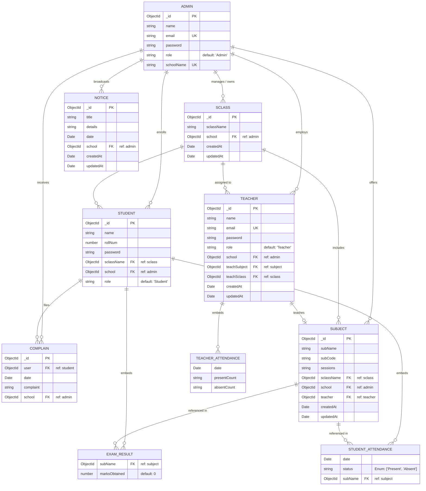

# Database Architecture & Data Workflows

**Edu-365** utilizes **MongoDB** with **Mongoose 7** as its Object Data Modeling (ODM) layer. The database design combines document-based referencing with targeted embedded subdocuments to model complex academic hierarchies, historical attendance tracking, and performance assessments.

---

## 📊 Entity-Relationship Diagram (ERD)



---

## 📑 Collection Schema Specifications

### 1. `admins` Collection (`adminSchema.js`)
Serves as the root tenant. Every school in the system is anchored to an Admin document.
- **`name`** (`String`, Required): Name of the administrator.
- **`email`** (`String`, Required, Unique): Login email address.
- **`password`** (`String`, Required): 10-round bcrypt hash.
- **`role`** (`String`, Default: `"Admin"`): System role discriminator.
- **`schoolName`** (`String`, Required, Unique): Institutional identifier across the platform.

### 2. `sclasses` Collection (`sclassSchema.js`)
Defines the class sections or standards (e.g., "Grade 10 - Section A").
- **`sclassName`** (`String`, Required): Display name of the class.
- **`school`** (`ObjectId`, Ref: `admin`, Required): Scopes the class to a school tenant.
- **`timestamps`**: Automatic `createdAt` and `updatedAt`.

### 3. `subjects` Collection (`subjectSchema.js`)
Represents individual academic courses belonging to a class.
- **`subName`** (`String`, Required): Title of subject (e.g., "Mathematics").
- **`subCode`** (`String`, Required): Unique course code within the school.
- **`sessions`** (`String`, Required): Planned lecture/lab session count.
- **`sclassName`** (`ObjectId`, Ref: `sclass`, Required): Parent classroom reference.
- **`school`** (`ObjectId`, Ref: `admin`): Owning institution.
- **`teacher`** (`ObjectId`, Ref: `teacher`, Optional): Assigned faculty instructor.

### 4. `teachers` Collection (`teacherSchema.js`)
Maintains faculty members, their pedagogical assignments, and session-level attendance logs.
- **`name`**, **`email`** (Unique), **`password`** (Hashed), **`role`** (Default: `"Teacher"`).
- **`school`** (`ObjectId`, Ref: `admin`, Required).
- **`teachSubject`** (`ObjectId`, Ref: `subject`): Allocated primary subject.
- **`teachSclass`** (`ObjectId`, Ref: `sclass`, Required): Allocated primary classroom.
- **`attendance`** (`Array` of embedded subdocuments):
  - `date` (`Date`, Required)
  - `presentCount` (`String`)
  - `absentCount` (`String`)

### 5. `students` Collection (`studentSchema.js`)
Maintains student credentials, class enrollment, and arrays of exam marks and subject attendances.
- **`name`** (`String`, Required).
- **`rollNum`** (`Number`, Required): Student roll identifier (scoped uniquely per class & school in controller).
- **`password`** (`String`, Required): Hashed password for student login.
- **`sclassName`** (`ObjectId`, Ref: `sclass`, Required).
- **`school`** (`ObjectId`, Ref: `admin`, Required).
- **`role`** (`String`, Default: `"Student"`).
- **`examResult`** (`Array` of embedded subdocuments):
  - `subName` (`ObjectId`, Ref: `subject`)
  - `marksObtained` (`Number`, Default: `0`)
- **`attendance`** (`Array` of embedded subdocuments):
  - `date` (`Date`, Required)
  - `status` (`String`, Enum: `['Present', 'Absent']`, Required)
  - `subName` (`ObjectId`, Ref: `subject`, Required)

### 6. `notices` Collection (`noticeSchema.js`)
Administrative broadcasts displayed on all portal homepages.
- **`title`** (`String`, Required), **`details`** (`String`, Required), **`date`** (`Date`, Required).
- **`school`** (`ObjectId`, Ref: `admin`): Isolates announcements per school.

### 7. `complains` Collection (`complainSchema.js`)
Student-submitted complaints routed to the school admin.
- **`user`** (`ObjectId`, Ref: `student`, Required): Submitting student.
- **`date`** (`Date`, Required), **`complaint`** (`String`, Required).
- **`school`** (`ObjectId`, Ref: `admin`, Required).

---

## 🔍 Data Population & Query Patterns

Mongoose `populate()` is utilized extensively across the API to assemble relational graphs without incurring excessive round trips:

### Common Query Aggregations

```javascript
// 1. Fetching a Student with Class, School, and Subject Details for Marks & Attendance
const student = await Student.findById(studentId)
  .populate("school", "schoolName")
  .populate("sclassName", "sclassName")
  .populate("examResult.subName", "subName")
  .populate("attendance.subName", "subName");

// 2. Fetching a Teacher with Class & Subject Information
const teacher = await Teacher.findById(teacherId)
  .populate("teachSubject", "subName sessions")
  .populate("school", "schoolName")
  .populate("teachSclass", "sclassName");

// 3. Fetching School Complaints with Submitter Name
const complaints = await Complain.find({ school: schoolId })
  .populate("user", "name");
```

---

## 🛡️ Referential Integrity & Uniqueness Guarantees

| Scope | Constraint Type | Enforced At | Behavior on Collision |
| :--- | :--- | :--- | :--- |
| `Admin.email` | Global Unique Index | MongoDB Schema | Duplicate Key Error (E11000) / Pre-check |
| `Admin.schoolName` | Global Unique Index | MongoDB Schema | Pre-check: "School name already exists" |
| `Teacher.email` | Global Unique Index | MongoDB Schema | Pre-check: "Email already exists" |
| `Sclass.sclassName` | Scoped per School | Controller Query | Pre-check: "Sorry this class name already exists" |
| `Student.rollNum` | Scoped per Class & School | Controller Query | Pre-check: "Roll Number already exists" |
| `Subject.subCode` | Scoped per School | Controller Query | Pre-check: "Sorry this subcode must be unique" |
