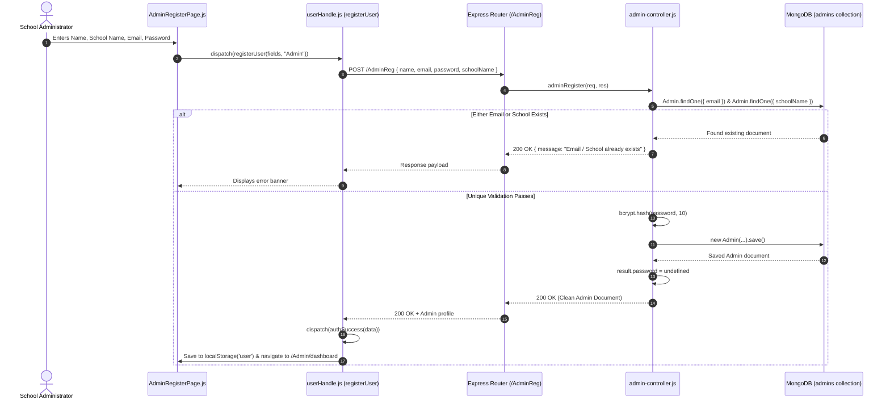
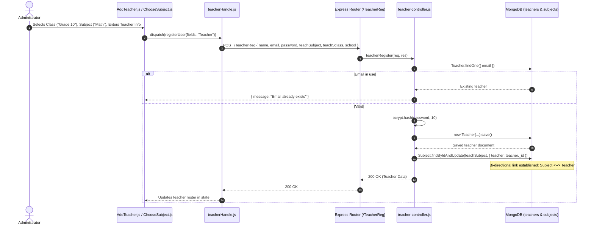
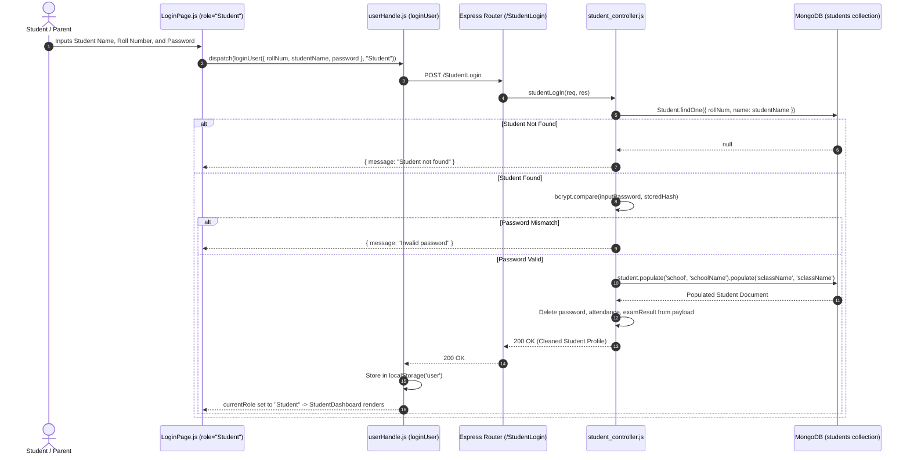
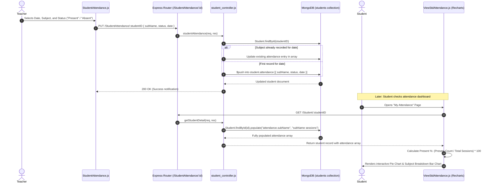
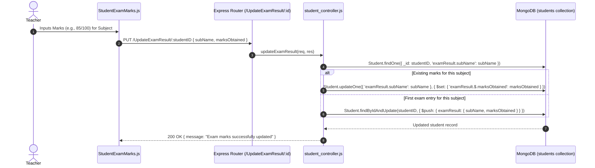
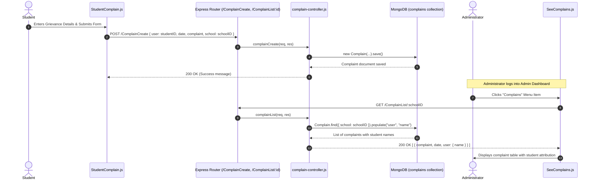

# End-to-End System Workflows & Sequence Diagrams

This document illustrates the complete cross-layer journeys across **Frontend**, **Backend**, and **Database** for key day-to-day operations in the Edu-365 School Management System.

---

## 1. 🏫 Admin Registration & School Onboarding

When a new school administrator joins the platform, the school entity and admin account are provisioned simultaneously.

---

## 2. 📚 Subject Creation & Teacher Allocation

Administrators link classes, subjects, and teachers to establish academic assignments.

---

## 3. 🎓 Student Enrollment & Role Authentication

---

## 4. 📅 Attendance Marking & Visual Analytics Workflow

This workflow tracks how an instructor records student presence and how that updates the student's visual analytics charts.

---

## 5. 📝 Exam Results Grading Workflow

---

## 6. 🚨 Grievance & Complaint Redressal Workflow

