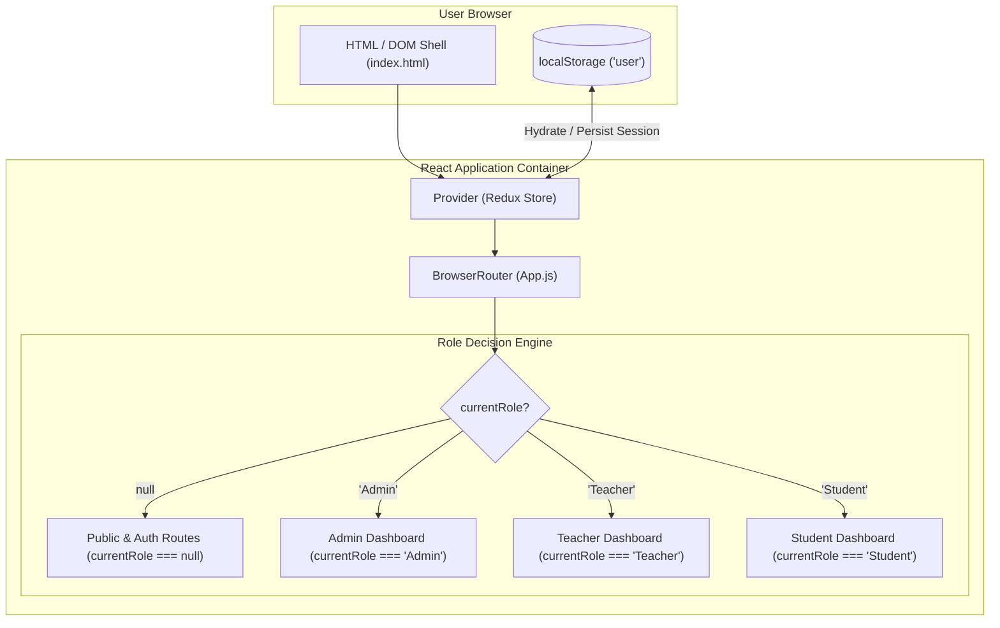
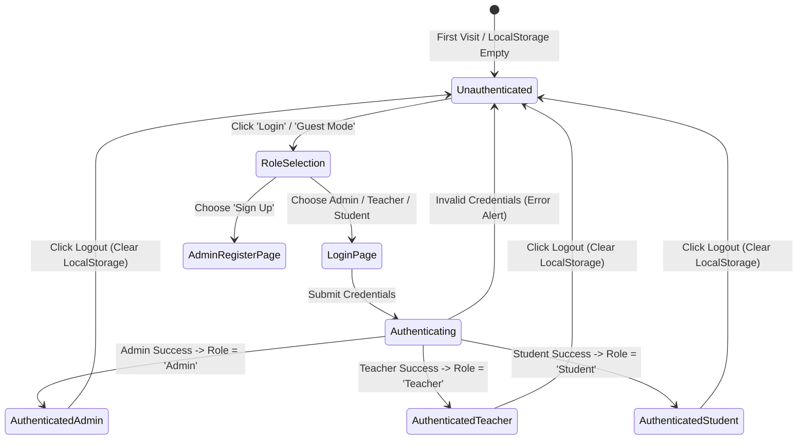
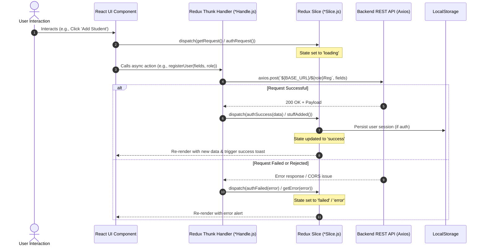

# Frontend Workflow & Architecture

The frontend of **Edu-365** is built with **React 18**, **Redux Toolkit**, **React Router v6**, and **Material UI (MUI v5)**. It delivers a role-based, dynamic Single-Page Application (SPA) experience tailored for Admins, Teachers, and Students.

---

## 🏗️ Architectural Overview



---

## 🚦 Routing & Access Control Flow

In `App.js`, the active user's state determines the entire rendering tree. The application uses a **flat conditional gate** rather than nested protected wrapper routes:

```javascript
const App = () => {
  const { currentRole } = useSelector(state => state.user);

  return (
    <Router>
      {currentRole === null && (
        <Routes>
          <Route path="/" element={<Homepage />} />
          <Route path="/choose" element={<ChooseUser visitor="normal" />} />
          <Route path="/chooseasguest" element={<ChooseUser visitor="guest" />} />
          <Route path="/Adminlogin" element={<LoginPage role="Admin" />} />
          <Route path="/Studentlogin" element={<LoginPage role="Student" />} />
          <Route path="/Teacherlogin" element={<LoginPage role="Teacher" />} />
          <Route path="/Adminregister" element={<AdminRegisterPage />} />
          <Route path="*" element={<Navigate to="/" />} />
        </Routes>
      )}

      {currentRole === "Admin" && <AdminDashboard />}
      {currentRole === "Student" && <StudentDashboard />}
      {currentRole === "Teacher" && <TeacherDashboard />}
    </Router>
  );
};
```

### Authentication State Transition Matrix



---

## 🔄 Redux Toolkit State Management

The frontend utilizes a modular Redux store configured in `src/redux/store.js`.

### Store Slices Breakdown

| Slice Name | Reducer | Managed Data & Purpose |
| :--- | :--- | :--- |
| `user` | `userReducer` | Active user session (`currentUser`), active role (`currentRole`), authentication status (`idle`, `loading`, `success`, `failed`, `error`), dark mode toggle. |
| `student` | `studentReducer` | Student collections for a school, individual student details, subject marks, attendance records. |
| `teacher` | `teacherReducer` | Faculty list, individual teacher details, assigned subjects, and teaching classes. |
| `sclass` | `sclassReducer` | Class sections (`sclasses`), students belonging to a class, and unassigned/free subjects. |
| `notice` | `noticeReducer` | School announcements list, creation status, and deletion signals. |
| `complain` | `complainReducer` | Student grievances list and submission state. |

### Redux Asynchronous Dataflow Cycle



---

## 💻 Portal Workflows by User Role

### 1. Admin Portal (`AdminDashboard.js`)
The Admin is the master administrator for a specific school.
- **SideBar Navigation:**
  - **Dashboard Home:** Quick count badges for Students, Classes, Teachers, Notices.
  - **Classes Section:**
    - `AddClass.js`: Create a class (e.g., "Grade 10").
    - `ShowClasses.js`: View all classes; click class to open `ClassDetails.js`.
    - `ClassDetails.js`: Tabbed view of enrolled students and assigned subjects; delete individual class.
  - **Subjects Section:**
    - `ChooseClass.js` -> `SubjectForm.js`: Assign subjects to classes (subName, subCode, sessions).
    - `ViewSubject.js`: View teachers and students taking this subject.
  - **Teachers Section:**
    - `AddTeacher.js`: Select class and subject to onboard new instructor.
    - `ShowTeachers.js` & `TeacherDetails.js`: View teacher profile and class duties.
  - **Students Section:**
    - `AddStudent.js`: Register student with Roll Number, Name, Class, Password.
    - `ShowStudents.js` & `ViewStudent.js`: View attendance records and test scores.
    - `StudentAttendance.js` & `StudentExamMarks.js`: Manual override for marks and attendance.
  - **Notices & Complains:**
    - `AddNotice.js` & `ShowNotices.js`: Publish school-wide circulars.
    - `SeeComplains.js`: Review complaints filed by students.

### 2. Teacher Portal (`TeacherDashboard.js`)
The Teacher interface focuses on daily classroom execution:
- **Dashboard Home:** Quick stats for student count and class timetable.
- **Class Management:**
  - `TeacherClassDetails.js`: View roster of students enrolled in the teacher's assigned class.
  - `TeacherViewStudent.js`: Drill into an individual student's historical academic journey.
- **Attendance & Grading:**
  - `StudentAttendance.js`: Mark individual or bulk student presence/absence per session.
  - `StudentExamMarks.js`: Input and update subject exam scores.
- **Feedback & Complaints:**
  - `TeacherComplain.js`: Submit faculty feedback or reports to administration.

### 3. Student Portal (`StudentDashboard.js`)
The Student (and Parent) interface is informative and self-service:
- **Dashboard Home:** Total subjects, attendance percentage gauge, upcoming announcements.
- **Academic Records:**
  - `StudentSubjects.js`: List of enrolled courses with allocated teachers and sessions.
  - `ViewStdAttendance.js`: Visual attendance charts powered by **Recharts** (Pie Chart and Bar Breakdown) calculating percentage against minimum thresholds.
  - `StudentForm.js`: View published exam marks across each subject.
- **Student Grievance:**
  - `StudentComplain.js`: Direct grievance submission form to the Admin.

---

## 🎨 Design System & UI Highlights

- **Component Library:** Built entirely using Material UI v5 (`@mui/material`, `@mui/icons-material`, `@mui/lab`).
- **Data Visualization:** Employs **Recharts** to render student attendance percentages and comparative grade charts.
- **Numeric Counter Animations:** Utilizes `react-countup` for animating statistics on dashboard cards.
- **Responsive Layout:** Responsive drawer sidebar collapsible via hamburger menu across desktop, tablet, and mobile breakpoints.
