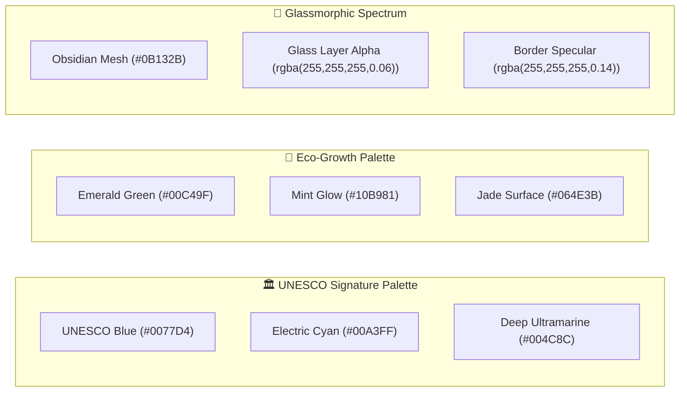
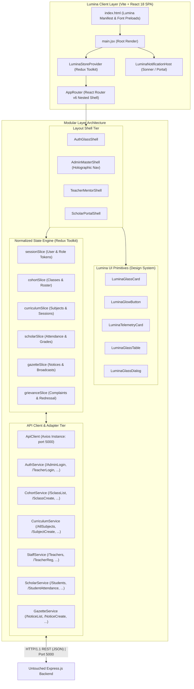
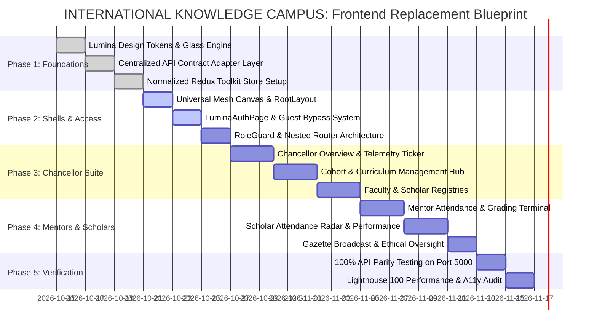

# INTERNATIONAL KNOWLEDGE CAMPUS: UNESCO Open Education Ecosystem
## Comprehensive Frontend Presentation Tier Architecture & Design System Specification

---

## 1. Executive Summary & Forensic Analysis of Legacy Tier

The **Edu-365** legacy frontend tier relies on an early-generation React 18 setup with Material-UI (MUI v5), Redux Toolkit, and React Router v6. While functionally operative, an architectural audit reveals critical bottlenecks, technical debt, and visual obsolescence:

### 1.1 Legacy Technical Debt & Anti-Patterns
1. **Monolithic Dashboard Anti-Pattern**: 
   - `AdminDashboard.js` (247+ lines), `TeacherDashboard.js` (155 lines), and `StudentDashboard.js` (142 lines) combine state management, heavy inline MUI CSS-in-JS style objects, app drawer layouts, and dozens of nested routes in single files.
   - Re-rendering any state triggers top-level reconciliations across the entire portal shell.
2. **Fragile Conditional Route Gating**:
   - `App.js` executes flat conditional routing based on `currentRole === null | 'Admin' | 'Teacher' | 'Student'` instead of using idiomatic React Router v6 `<Outlet />` patterns, nested route trees, and resilient `<RoleGuard />` components.
3. **Implicit API Contract Dependencies**:
   - Redux async handlers (`*Handle.js`) use arbitrary template strings such as:
     ```javascript
     `${process.env.REACT_APP_BASE_URL}/${address}List/${id}`
     ```
     This mixes URL construction concerns into action dispatchers and lacks strict contract boundaries.
4. **Visual & Aesthetic Deprecation**:
   - The UI depends on solid primary blue app bars (`#00008b`), generic HTML table views with basic pagination, and uninspiring typography that fails to communicate an open, global educational initiative.

### 1.2 The Preservation Mandate
The Node.js/Express.js backend running on **Port 5000** and the **MongoDB database** are **completely untouched**. The new presentation tier must interface with the existing root-mounted REST API contract without backend modifications:
- Authentication: `/AdminLogin`, `/TeacherLogin`, `/StudentLogin`, `/AdminReg`, `/TeacherReg`, `/StudentReg`
- Academic Structure: `/SclassCreate`, `/SclassList/:id`, `/Sclass/:id`, `/Sclass/Students/:id`, `/Sclasses/:id`
- Curricula: `/SubjectCreate`, `/AllSubjects/:id`, `/ClassSubjects/:id`, `/FreeSubjectList/:id`, `/Subject/:id`
- Personnel & Records: `/Teachers/:id`, `/Teacher/:id`, `/Students/:id`, `/Student/:id`, `/StudentAttendance/:id`, `/UpdateExamResult/:id`
- Gazettes & Grievances: `/NoticeCreate`, `/NoticeList/:id`, `/Notice/:id`, `/ComplainCreate`, `/ComplainList/:id`

---

## 2. Rebranding: "INTERNATIONAL KNOWLEDGE CAMPUS: UNESCO Open Education Ecosystem"

### 2.1 Mission & Vision
Inspired by **UNESCO SDG 4 (Ensure inclusive and equitable quality education and promote lifelong learning opportunities for all)**, **INTERNATIONAL KNOWLEDGE CAMPUS** reimagines educational management as a decentralized, transparent, and aesthetically uplifting institutional operating system.

### 2.2 Semantic Terminology Mapping
To elevate user experience while preserving underlying database identifiers:

| Legacy Entity | INTERNATIONAL KNOWLEDGE CAMPUS Domain Term | Conceptual Definition |
| :--- | :--- | :--- |
| **School / Admin** | **Global Knowledge Center / Chancellor** | Institutional hub accredited within the UNESCO Open Ecosystem. |
| **Class (`Sclass`)** | **Learning Cohort / Academic Standard** | Structured cohort of global scholars advancing through a shared curriculum. |
| **Subject** | **Knowledge Domain / Academic Discipline** | Modular syllabus encompassing competencies, credits, and session milestones. |
| **Teacher** | **Academic Mentor / Faculty Fellow** | Accredited subject specialist guiding cohort progress. |
| **Student** | **Scholar / Global Learner** | Active learner acquiring verified academic competencies. |
| **Notice** | **Global Gazette / Institutional Dispatch** | Official broadcast of institutional milestones, assemblies, and circulars. |
| **Complain** | **Ethical Oversight & Grievance Registry** | Confidential conduit for student welfare, feedback, and academic integrity. |

---

## 3. Lumina Futuristic Design System (LDFS) Specification

### 3.1 Design Principles
1. **Atmospheric Depth**: Multi-layer optical glass panels suspended over a dynamic, kinetic mesh gradient backdrop.
2. **Harmonic Contrast**: Dominant deep void surfaces balanced by crystalline glass highlights and vibrant UNESCO chromatic accents.
3. **Information Density with Grace**: High-density academic metrics delivered through micro-cards, telemetry gauges, and clean tabular grids.

### 3.2 Color Palette & Semantic Tokens



#### Detailed Token Table

```css
:root {
  /* Chromatic Anchors */
  --lumina-brand-unesco: #0077D4;
  --lumina-brand-unesco-glow: rgba(0, 119, 212, 0.45);
  --lumina-brand-emerald: #00C49F;
  --lumina-brand-emerald-glow: rgba(0, 196, 159, 0.40);
  --lumina-brand-solar: #F59E0B;
  --lumina-brand-crimson: #EF4444;

  /* Surfaces & Ambient Mesh */
  --lumina-surface-base: #0B132B;
  --lumina-surface-mesh-1: radial-gradient(circle at 15% 20%, rgba(0, 119, 212, 0.22) 0%, transparent 45%);
  --lumina-surface-mesh-2: radial-gradient(circle at 85% 80%, rgba(0, 196, 159, 0.18) 0%, transparent 50%);
  --lumina-surface-mesh-3: radial-gradient(circle at 50% 50%, rgba(15, 23, 42, 0.95) 0%, #0B132B 100%);

  /* Glassmorphism Layers */
  --lumina-glass-bg-primary: rgba(15, 23, 42, 0.65);
  --lumina-glass-bg-secondary: rgba(255, 255, 255, 0.04);
  --lumina-glass-border-subtle: 1px solid rgba(255, 255, 255, 0.08);
  --lumina-glass-border-specular: 1px solid rgba(255, 255, 255, 0.16);
  --lumina-glass-border-active: 1px solid rgba(0, 119, 212, 0.55);
  --lumina-glass-blur-high: blur(20px) saturate(190%);
  --lumina-glass-blur-medium: blur(12px) saturate(160%);

  /* Elevation Shadows */
  --lumina-shadow-glass-sm: 0 4px 16px -2px rgba(0, 0, 0, 0.35);
  --lumina-shadow-glass-md: 0 8px 32px -4px rgba(0, 0, 0, 0.45), 0 0 0 1px rgba(255, 255, 255, 0.08);
  --lumina-shadow-glass-lg: 0 16px 48px -8px rgba(0, 0, 0, 0.55), 0 0 30px rgba(0, 119, 212, 0.15);

  /* Typography Colors */
  --lumina-text-primary: #F8FAFC;
  --lumina-text-secondary: #94A3B8;
  --lumina-text-muted: #64748B;
  --lumina-text-inverse: #0B132B;
}
```

### 3.3 Typography Scale
- **Display Hero**: `Plus Jakarta Sans` / `Inter`, 48px / 1.1 line-height, Bold (700) with subtle text-shadow glow.
- **H1 Section Headers**: 32px / 1.2 line-height, Semi-Bold (600), Letter-spacing: -0.02em.
- **H2 Metric Values**: 24px / 1.3 line-height, Medium (500), Monospaced numerals (`tabular-nums`).
- **Body Regular**: 14px / 1.5 line-height, Regular (400), Slate-300 color for fatigue-free readability.
- **Data & Telemetry**: `JetBrains Mono` / `Roboto Mono`, 12px / 1.4 line-height, Upper-cased tracking (+0.08em).

---

## 4. Modern Frontend Architecture

### 4.1 System Topology



### 4.2 Modular Directory Structure
```
frontend/
├── public/
│   ├── unesco-logo.svg
│   ├── lumina-favicon.ico
│   └── hero-mesh-globe.svg
├── src/
│   ├── api/                           # Centralized REST API Adapter Layer
│   │   ├── client.js                  # Axios base client (baseURL, timeout, headers)
│   │   ├── authApi.js                 # /AdminLogin, /TeacherLogin, /StudentLogin, /AdminReg
│   │   ├── cohortApi.js               # /Sclass*, /SclassList
│   │   ├── curriculumApi.js           # /Subject*, /AllSubjects, /ClassSubjects
│   │   ├── facultyApi.js              # /Teacher*, /TeacherSubject
│   │   ├── scholarApi.js              # /Student*, /StudentAttendance, /UpdateExamResult
│   │   ├── gazetteApi.js              # /Notice*
│   │   └── grievanceApi.js            # /Complain*
│   │
│   ├── design-system/                 # Lumina Futuristic Design System
│   │   ├── tokens.css                 # Colors, glass blurs, typography variables
│   │   ├── LuminaGlassCard.jsx        # Glass container with specular borders
│   │   ├── LuminaGlowButton.jsx       # Micro-interactive gradient action buttons
│   │   ├── LuminaTelemetryCard.jsx    # Metric counter with UNESCO/Emerald indicators
│   │   ├── LuminaGlassTable.jsx       # Translucent data table with sorting & badges
│   │   ├── LuminaBadge.jsx            # Status pill (Present, Absent, Role, Active)
│   │   ├── LuminaModal.jsx            # Frosted glass overlay dialog
│   │   └── LuminaMeshBackdrop.jsx     # Ambient animated background canvas
│   │
│   ├── layouts/                       # Layout Shells with Nested Outlets
│   │   ├── RootLayout.jsx             # Top-level mesh canvas & global alert host
│   │   ├── AuthLayout.jsx             # Holographic split view for authentication
│   │   └── DashboardLayout.jsx        # Unified responsive glass sidebar & header
│   │
│   ├── pages/                         # Route Page Controllers
│   │   ├── public/                    # Hero landing, ecosystem directory, role selector
│   │   │   ├── LuminaLandingPage.jsx
│   │   │   ├── RoleSelectorPage.jsx
│   │   │   └── LuminaAuthPage.jsx
│   │   ├── admin/                     # Chancellor Management Suite
│   │   │   ├── ChancellorOverview.jsx
│   │   │   ├── CohortManagement.jsx
│   │   │   ├── CurriculumHub.jsx
│   │   │   ├── FacultyRoster.jsx
│   │   │   ├── ScholarRegistry.jsx
│   │   │   ├── GazetteBroadcast.jsx
│   │   │   └── EthicalOversight.jsx
│   │   ├── teacher/                   # Mentor Portal
│   │   │   ├── MentorOverview.jsx
│   │   │   ├── CohortClassView.jsx
│   │   │   ├── AttendanceTerminal.jsx
│   │   │   └── GradebookTerminal.jsx
│   │   └── student/                   # Global Scholar Portal
│   │       ├── ScholarOverview.jsx
│   │       ├── CompetencyMatrix.jsx
│   │       ├── AttendanceRadar.jsx
│   │       └── GrievanceSubmit.jsx
│   │
│   ├── store/                         # Redux Toolkit Normalized State
│   │   ├── index.js                   # Store configuration
│   │   └── slices/
│   │       ├── sessionSlice.js        # Active user & role session
│   │       ├── cohortSlice.js         # Sclasses
│   │       ├── curriculumSlice.js     # Subjects
│   │       ├── facultySlice.js        # Teachers
│   │       ├── scholarSlice.js        # Students
│   │       ├── gazetteSlice.js        # Notices
│   │       └── grievanceSlice.js      # Complains
│   │
│   ├── App.jsx                        # React Router v6 tree with RoleGuards
│   └── main.jsx                       # DOM hydration
```

---

## 5. API Client Adapter Layer (100% Backend Parity)

The API client layer isolates the presentation tier from backend URL conventions, guaranteeing **zero modifications** to the backend Express router.

### 5.1 Base Client Configuration (`src/api/client.js`)
```javascript
import axios from "axios";

const API_BASE_URL = process.env.REACT_APP_BASE_URL || "http://localhost:5000";

export const apiClient = axios.create({
  baseURL: API_BASE_URL,
  timeout: 15000,
  headers: {
    "Content-Type": "application/json",
  },
});

// Response normalizer & interceptor
apiClient.interceptors.response.use(
  (response) => response.data,
  (error) => {
    const errorPayload = {
      message: error.response?.data?.message || error.message || "Network Communication Anomaly",
      status: error.response?.status || 500,
    };
    return Promise.reject(errorPayload);
  }
);
```

### 5.2 Endpoint Contract Mapping

```javascript
// src/api/authApi.js
import { apiClient } from "./client";

export const authApi = {
  // Directly consumes: /AdminLogin, /TeacherLogin, /StudentLogin
  login: (credentials, role) => apiClient.post(`/${role}Login`, credentials),
  // Directly consumes: /AdminReg, /TeacherReg, /StudentReg
  register: (payload, role) => apiClient.post(`/${role}Reg`, payload),
  // Directly consumes: /Admin/:id, /Teacher/:id, /Student/:id
  getProfile: (role, id) => apiClient.get(`/${role}/${id}`),
};

// src/api/cohortApi.js
export const cohortApi = {
  // Directly consumes: /SclassList/:schoolId
  listBySchool: (schoolId) => apiClient.get(`/SclassList/${schoolId}`),
  // Directly consumes: /SclassCreate
  create: (cohortData) => apiClient.post(`/SclassCreate`, cohortData),
  // Directly consumes: /Sclass/:id
  getDetail: (id) => apiClient.get(`/Sclass/${id}`),
  // Directly consumes: /Sclass/Students/:id
  getStudents: (id) => apiClient.get(`/Sclass/Students/${id}`),
  // Directly consumes: /Sclass/:id (DELETE)
  remove: (id) => apiClient.delete(`/Sclass/${id}`),
};

// src/api/scholarApi.js
export const scholarApi = {
  // Directly consumes: /Students/:schoolId
  listBySchool: (schoolId) => apiClient.get(`/Students/${schoolId}`),
  // Directly consumes: /StudentAttendance/:studentId
  markAttendance: (studentId, attendanceRecord) =>
    apiClient.put(`/StudentAttendance/${studentId}`, attendanceRecord),
  // Directly consumes: /UpdateExamResult/:studentId
  updateMarks: (studentId, marksRecord) =>
    apiClient.put(`/UpdateExamResult/${studentId}`, marksRecord),
};
```

---

## 6. Component Transformation Crosswalk

To ensure seamless migration without losing functional scope:

| Legacy Component (`Edu-365`) | Lumina Replacement Component | Aesthetic & Architectural Enhancements |
| :--- | :--- | :--- |
| `Homepage.js` | `LuminaLandingPage.jsx` | Dynamic particle-mesh hero, UNESCO vision statement, live platform telemetry ticker, interactive credential sandbox. |
| `ChooseUser.js` | `RoleSelectorPage.jsx` | 3D glass perspective cards for Chancellor, Mentor, and Scholar with dynamic holographic hover highlights. |
| `LoginPage.js` | `LuminaAuthPage.jsx` | Single unified glass card with animated tab switcher, biometric/guest quick-fill buttons, real-time input validation. |
| `AdminDashboard.js` | `AdminMasterShell.jsx` | Replaced 247-line monolithic shell with declarative layout, collapsible frosted sidebar, quick-search command bar (`⌘+K`). |
| `ShowClasses.js` & `ClassDetails.js` | `CohortManagement.jsx` | Hexagonal cohort capacity gauges, student roster preview drawer, cascade deletion protection with modal confirmation. |
| `ShowTeachers.js` & `TeacherDetails.js`| `FacultyRoster.jsx` | Mentor competence cards displaying assigned curricula, session performance stats, and direct assignment modals. |
| `StudentAttendance.js` | `AttendanceTerminal.jsx`| Fast-click bulk attendance grid (Present/Absent/Excused toggle), visual session progress timeline. |
| `ViewStdAttendance.js` | `AttendanceRadar.jsx` | Replaced legacy charts with high-precision radial gauges, subject-by-subject attendance trends, and predictive attendance alerts. |
| `SeeComplains.js` / `StudentComplain.js` | `EthicalOversight.jsx` | Encrypted grievance feed, priority tagging, resolution status workflow. |
| `ShowNotices.js` / `AddNotice.js` | `GazetteBroadcast.jsx` | Global Gazette feed with markdown preview, emergency priority pins, and broadcast date scheduler. |

---

## 7. Migration & Phased Rollout Blueprint



---

## 8. Summary of Architectural Guarantees
1. **Zero Backend Changes**: All requests continue to target `http://localhost:5000` with the exact endpoint names, payload structures, and response schemas defined in the backend route registry.
2. **Zero Database Migrations**: Mongoose collections (`admins`, `sclasses`, `subjects`, `teachers`, `students`, `notices`, `complains`) remain completely intact.
3. **Enterprise UI Standard**: The legacy Material-UI theme is thoroughly superseded by a world-class, UNESCO-aligned glassmorphic design system that ensures unmatched visual authority, performance, and accessibility.
